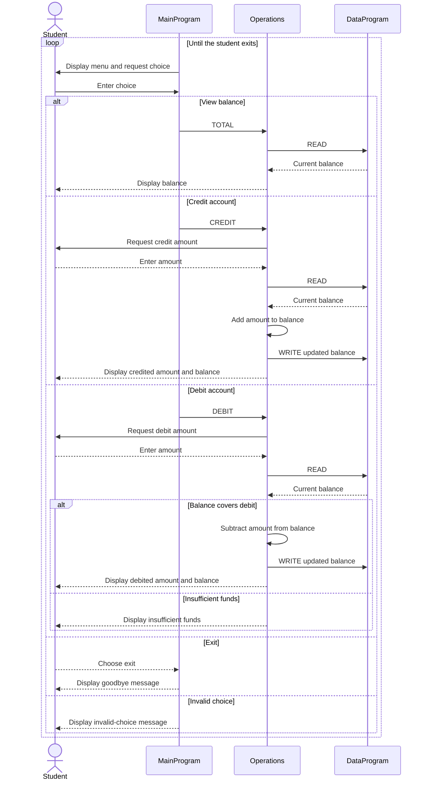

# COBOL Account Management

This directory documents the COBOL account-management example in `src/cobol/`.
The program provides a menu for viewing an account balance, crediting an
account, and debiting an account. Although this documentation refers to
student accounts, the current implementation does not store student names,
IDs, or separate balances for multiple students; it manages one balance.

## COBOL files

### `src/cobol/main.cob` — `MainProgram`

Entry point and interactive menu. It repeatedly accepts a choice and calls
`Operations` to:

- View the balance (`TOTAL`)
- Credit the account (`CREDIT`)
- Debit the account (`DEBIT`)
- Exit the program

Choices outside 1–4 display an invalid-choice message and return to the menu.

### `src/cobol/operations.cob` — `Operations`

Implements the account actions and user interaction:

- `TOTAL` reads and displays the current balance.
- `CREDIT` accepts an amount, reads the balance, adds the amount, saves the
  result, and displays it.
- `DEBIT` accepts an amount and checks whether the balance covers it. If so,
  it subtracts and saves the amount; otherwise, it displays an insufficient
  funds message and leaves the balance unchanged.

### `src/cobol/data.cob` — `DataProgram`

Stores the account balance in working storage and exposes it to `Operations`
through `READ` and `WRITE` operations. The stored balance starts at `1000.00`
and exists only for the lifetime of the running program; it is not persisted
to a file or database.

## Student-account business rules currently implemented

- The account starts with a balance of **1000.00**.
- A credit increases the balance by the amount entered.
- A debit is allowed only when the current balance is at least the debit
  amount. Otherwise, the balance is not changed.
- There is no separate student-account record or per-student balance.
- The code does not add validation for negative or zero transaction amounts,
  nor does it enforce account-specific limits.

## Application data flow

